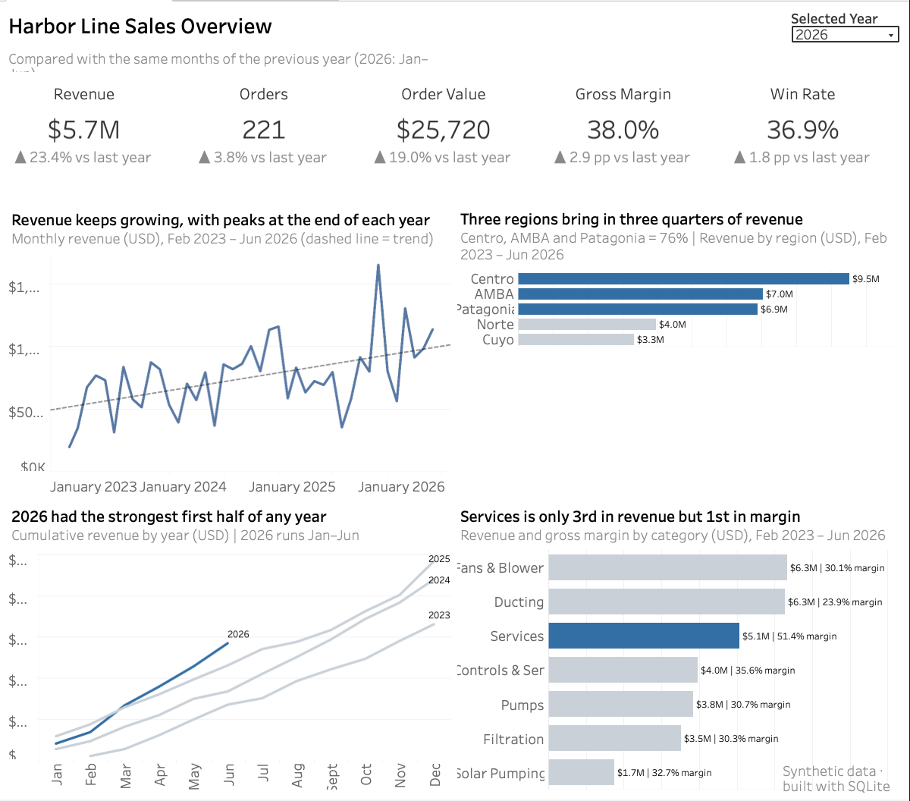
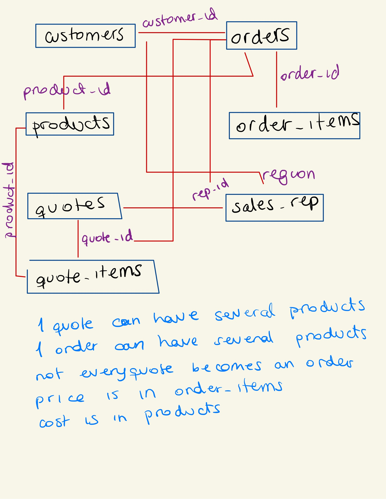
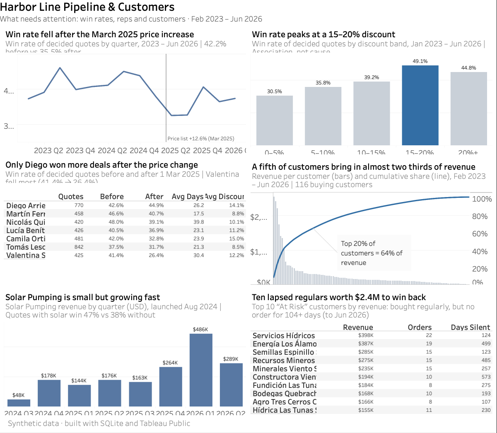

# Customer & Sales Analysis: Harbor Line Industrial

A SQL and Tableau analysis of 3.5 years of quote-to-order data for a fictional B2B equipment supplier. I cleaned the data, built an analysis base in SQLite, answered 19 business questions, and turned the main findings into two Tableau Public dashboards.

**[View the interactive dashboards on Tableau Public](https://public.tableau.com/app/profile/pilar.gottert/viz/HarborLineSalesDashboard/Dashboard1-SalesOverview)** · **[Read the case study](https://pilargottert.github.io/customer-sales-analysis.html)**



> **All data is synthetic.** Harbor Line Industrial, its customers and its sales reps are invented. The data was generated with `generate_data.py` (fixed seed), including deliberate data-quality problems to clean.

---

## The business question

Harbor Line sells fans, ducting, filtration, pumps, controls, services and (from 2024) solar pumping kits to industrial customers across five Argentine regions. Every sale starts as a quote, and only some quotes become orders.

**How is the business performing, what is driving revenue and profit, and where should sales focus next?**

## Key findings

| # | Finding | Evidence | Recommendation |
|---|---|---|---|
| 1 | **A hidden 12.6% price increase raised profit but lost customers** | Win rate fell from 43.4% to 36.0% in the 12 months after March 2025, but gross margin rose from 30.0% to 37.5% and gross profit grew about 21% | Keep the new prices and start a win-back with the regular customers who stopped buying around the change |
| 2 | **Revenue depends on a few customers** | The top 20% of customers bring in 64.1% of revenue; in Norte, one customer is 55.6% of the region | Give each top account a named owner and grow the next tier of customers |
| 3 | **Solar Pumping is small, growing fast and easier to win** | Jan–Jun 2026 revenue ($774K) already beat all of 2025 ($747K); quotes with solar products win 47.1% vs 37.7% | Offer solar products to agricultural customers, starting in Centro |
| 4 | **Services earns a quarter of all profit** | 16.5% of revenue but 25.5% of gross profit (51.4% margin), vs Ducting at 23.9% | Attach Annual Maintenance to equipment quotes and review Ducting pricing |
| 5 | **Five customers take 10% of quoting work for 2% of revenue** | 393 of 3,822 quotes, $713K revenue, 12–18% win rate vs 38.5% average | Add a qualification step before re-quoting these customers |

The full analysis, with every query, result table and check, is in [`findings.md`](findings.md).

## Data

7 tables from a quote-to-order process. Quotes from January 2023, orders from February 2023, data extracted June 30, 2026.

| Table | Rows | One row = one... |
|---|---|---|
| `sales_reps` | 7 | sales rep |
| `customers` | 124 | customer (incl. 4 duplicates) |
| `products` | 24 | product |
| `quotes` | 3,822 | quote (won, lost or pending) |
| `quote_items` | 7,280 | product within a quote |
| `orders` | 1,467 | order (only won quotes become orders) |
| `order_items` | 2,832 | product within an order (incl. 14 duplicates) |



## Approach

1. **Profiling:** checked the grain of every table, the relationships between them, date ranges and distinct values.
2. **Cleaning:** built clean views on top of the raw tables, without editing the originals.
3. **Analysis base:** two wide views, `sales_lines` (one row per order line) and `quote_summary` (one row per quote), reconciled to the source totals.
4. **Analysis:** 19 business questions, from headline KPIs to window functions, churn and RFM segmentation.
5. **Insights:** chose five findings that are surprising, have money attached, and that someone could act on.
6. **Dashboards:** exported four views to CSV and built two dashboards in Tableau Public.

### Data cleaning

| Problem | Fix | Impact if left in |
|---|---|---|
| 14 exact duplicate order lines | `SELECT DISTINCT` in `order_items_clean` | Revenue overstated by 0.39% (~$120K) |
| ~15 spellings of 5 regions (case, spaces, `Buenos Aires (AMBA)`, `NOA`) | `CASE WHEN LOWER(TRIM(region))...` | Regions split across several labels |
| Missing industry for 8 customers | `COALESCE(industry, 'Unknown')` | Customers dropped from industry breakdowns |
| 4 companies entered twice under different IDs | `customer_map` table mapping each duplicate to the original ID | Customer revenue split in two; one customer looked churned but wasn't |

Two things I found along the way:
- **SQLite's `LOWER()` doesn't convert accented capitals** (`LOWER('HÍDRICOS')` returns `hÍdricos`), which hid the fourth duplicate customer until I replaced accented letters first.
- **The list price wasn't valid for the whole period.** The average ratio of quoted price to list price jumped from 0.89 to 1.00 in March 2025, which revealed an undocumented 12.6% price increase. Without correcting for it, discounts after March 2025 would have looked like 0%.

### Checks

Every view was reconciled against its source: `sales_lines` matches `order_items_clean` exactly on rows (2,818) and revenue ($30,771,551.71), and `quote_summary` has all 3,822 quotes.

## Dashboards

Built in Tableau Public from the four CSVs in `outputs/`.

| Dashboard | What it shows |
|---|---|
| **Sales Overview** | KPIs by year (vs the same months of the previous year), monthly revenue trend, cumulative revenue by year, revenue by region, revenue and margin by category |
| **Pipeline & Customers** | Win rate before and after the price change, win rate by discount band and by rep, revenue concentration, Solar Pumping growth, top "At Risk" customers to win back |



## Repository structure

```
├── README.md
├── findings.md              Full analysis: method, query, results and findings for every step
├── schema.sql               Table definitions
├── generate_data.py         Builds the synthetic database (Python standard library, fixed seed)
├── harbor_line.db           SQLite database, including my clean views
├── data/                    Raw tables as CSV
├── queries/
│   ├── 01_profiling/        Table grain, date ranges, distinct values
│   ├── 02_cleaning/         Clean views, customer_map and checks
│   ├── 03_analysis_base/    sales_lines and quote_summary views, price-change detection
│   ├── 04_overview/         KPIs, revenue, win rates, customers, reps, margin, discounts (Q1–Q10)
│   └── 05_advanced/         Window functions, churn, RFM, price change, Solar Pumping (Q11–Q19)
├── outputs/                 Views exported to CSV for Tableau
├── dashboard/               Dashboard screenshots
└── docs/                    ERD sketch
```

## How to explore it

1. Open `harbor_line.db` in [DB Browser for SQLite](https://sqlitebrowser.org/) (free). The clean views (`customers_clean`, `sales_lines`, `quote_summary` and others) are already saved in it.
2. Run any file from `queries/` in the *Execute SQL* tab.
3. To rebuild the raw database from scratch: `python generate_data.py`.

## Limitations

The data is synthetic, and some things a real company would track are missing:
- **Time spent on each quote**, which would put a cost on lost quotes.
- **Reasons for lost quotes and lapsed customers.** Today the link between the price increase and the customers who left is based on timing.
- **Competitor prices**, which would show where the company is priced above the market.

The dataset also came with an answer key listing the patterns built into the data. I opened it only after finishing my analysis, to check what I had found and missed. The check is at the end of `findings.md`.

## Tools

SQLite (DB Browser for SQLite) · Tableau Public · Python (data generation)

---

**Pilar Göttert** · [Portfolio](https://pilargottert.github.io) · [LinkedIn](https://linkedin.com/in/pilar-gottert)
